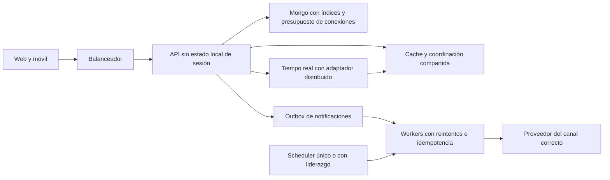

# Auditoría de EventNow — 20 de octubre de 2026

**Decisión: no aceptar todavía un lanzamiento público amplio.** Hay una base funcional con muchas pruebas aprobadas, pero se reprodujeron contratos rotos y siguen abiertos bloqueos de seguridad, despliegue y operación. Añadir funciones no cierra esos bloqueos.

Esta es una auditoría de código, contratos, pruebas y posicionamiento; no se presenta como revisión visual actual de todas las pantallas, pentest certificado ni validación de usuarios reales. No se inició el API principal, no se tocó una base de producción, no se desplegó y no se enviaron correos, push o mensajes externos. Los cambios de esta auditoría son documentos y sondas de prueba.

## Evidencia ejecutada

| Conjunto configurado | Aprobadas | Fallidas | Omitidas | Resultado |
| --- | ---: | ---: | ---: | --- |
| Web, Vitest completo, 77 archivos | 462 | 1 | 1 | No verde |
| Móvil, Jest completo, 32 conjuntos | 185 | 0 | 0 | Verde |
| API, Jest configurado, 38 conjuntos | 470 | 5 | 1 | No verde |
| **Total de los conjuntos configurados** | **1117** | **6** | **2** | **1125 casos** |

Se añadieron **ocho sondas de lanzamiento separadas**: cinco de API/servicio y tres del adaptador móvil. Las ocho fallan contra el comportamiento requerido y demuestran los defectos REC-01, REC-02, NOT-01, NOT-02 y NOT-03. No se suman al total anterior. Están fuera del patrón habitual para distinguir esta caracterización de la batería existente; al corregir los defectos deben convertirse en regresiones incluidas en CI.

- La prueba de PrivacySettings que falló en la batería general pasó al repetir sus tres casos de forma aislada. La causa de esa inestabilidad queda pendiente; no se clasifica como un fallo de privacidad reproducido.
- Performance de API falló en dos casos también en la repetición aislada. Un límite de memoria del harness y un contrato/fixture de creación no certifican ni descartan una fuga real o una capacidad de producción.
- Parte de las fallas de eventos/pagos usa expectativas de publicación/participación que deben reconciliarse con la moderación actual. No se debe hacer público un evento pendiente para poner verde un test.
- No se ejecutó cobertura en esta batería; no se acredita el umbral del 70 % de CI.
- Los tests de integración contra un servidor externo están excluidos por la configuración de API. El setup general simula QR/TOTP; hace falta validación específica del segundo factor real.
- Registros completos: `E:/CodexBuilds/audit-20261020/`. Los registros contienen datos ficticios de pruebas, no una observación de producción.

Sondas reproducibles: [API y servicio](<C:/Users/Raili/OneDrive/Nueva carpeta/Imágenes/EVENT NOW 2.0/backend-api/tests/audit-probes.launch.js>) y [adaptador móvil](<C:/Users/Raili/OneDrive/Nueva carpeta/Imágenes/EVENT NOW 2.0/mobile-app/audit-notification-contract.launch.ts>). Se ejecutan desde su proyecto con `node node_modules/jest/bin/jest.js --testMatch '**/audit-probes.launch.js' --runInBand --coverage=false` y `--testMatch '**/audit-notification-contract.launch.ts'`, respectivamente. El proyecto API usa la base efímera de su setup; nunca apuntar estas pruebas a una base de producción.

El archivo `AUDIT-EVIDENCE-2026-10-20.json` registra HEAD, estado de trabajo local y hashes de las fuentes revisadas. Es una instantánea del workspace con cambios sin commit; no representa una versión desplegada. `AUDIT-FINDINGS-2026-10-20.json` permite seguir cada hallazgo sin confundirlo con una medición visual o de producción. El HTML es un visor local filtrable del resumen; el detalle de mercado y criterios está en este documento.

## Dependencias

Se ejecutó `npm audit --omit=dev --json` contra los lockfiles, sin actualizar paquetes.

| Proyecto | Críticos | Altos | Moderados | Bajos | Total |
| --- | ---: | ---: | ---: | ---: | ---: |
| Web | 1 | 18 | 3 | 0 | 22 |
| API | 4 | 21 | 15 | 1 | 41 |
| Móvil | 0 | 57 | 18 | 2 | 77 |

Estos valores cuentan paquetes afectados según npm, no vulnerabilidades únicas ni explotaciones demostradas. En móvil hay herramientas de compilación/test declaradas como dependencias, por lo que `--omit=dev` no equivale al contenido exacto del binario instalado. Revisar exposición y rutas transitivas antes de decidir severidad efectiva. No se aplicó un `audit fix --force`.

## Hallazgos priorizados

28 hallazgos o brechas de aceptación: **4 P0**, **17 P1**, **7 P2**. La prioridad indica el orden propuesto de cierre para lanzar, no una puntuación de éxito comercial.

- **P0:** cerrar antes de exposición pública amplia.
- **P1:** cerrar o acotar explícitamente antes del piloto del recorrido afectado.
- **P2:** mejorar con pruebas de uso; no confundir una hipótesis de diseño con un fallo observado.

| ID | Prioridad | Área | Hallazgo | Evidencia |
| --- | --- | --- | --- | --- |
| REC-01 | P1 | Recomendaciones | La ruta pública de recomendaciones devuelve 500 | Reproducido |
| REC-02 | P0 | Seguridad y recomendaciones | El motor antiguo no aplica edad ni protege ubicaciones secretas | Reproducido en servicio |
| SEC-01 | P0 | Dependencias | Hay dependencias con avisos críticos | Auditoría de registro |
| DEP-01 | P0 | Despliegue | Los Dockerfile esperan artefactos que Next no genera con la configuración actual | Confirmado por código |
| SEC-02 | P0 | Configuración | Compose contiene valores compartidos de credenciales y publica las bases | Confirmado por código; exposición real no verificada |
| NOT-01 | P1 | Notificaciones | El adaptador móvil no coincide con el listado y contador del API | Tres sondas reproducidas |
| NOT-02 | P1 | Notificaciones | El evento Socket.IO entrega una envoltura distinta a la esperada por móvil | Reproducido |
| NOT-03 | P1 | Preferencias | Un endpoint informa que guardó preferencias sin persistirlas | Reproducido |
| NOT-04 | P1 | Push | El token Expo se registra en un recorrido de envío directo a FCM | Incompatibilidad de código; entrega física pendiente |
| NOT-05 | P2 | Usabilidad de avisos | La acción Ver del aviso emergente no navega | Confirmado por código |
| SEC-03 | P1 | Operación segura | Los errores de conexión pueden registrar la URI completa de Mongo | Confirmado por código |
| SCA-01 | P1 | Escalabilidad | Cada réplica inicia el scheduler | Confirmado por arquitectura; sin carga distribuida |
| SCA-02 | P1 | Tiempo real | Presencia y difusión entre réplicas no están resueltas | Confirmado por arquitectura |
| SCA-03 | P1 | Límites y abuso | Los límites dependen del proceso y requieren validar la topología del proxy | Confirmado por arquitectura |
| SCA-04 | P1 | Modelo de datos | Un documento de evento admite aforo de un millón y contiene arrays de asistentes y vistas | Riesgo de crecimiento; no medido |
| SCA-05 | P2 | Carga de lectura | La votación abierta consulta cada quince segundos | Código y cálculo de escenario |
| DAT-01 | P1 | Calidad de datos y abuso | La ingesta de analytics confía en identidad y propiedades del cliente | Confirmado por código |
| DAT-02 | P1 | Retención de datos | El cron elimina eventos expirados antiguos sin una política visible de referencias | Confirmado por código |
| DAT-03 | P2 | Producto y medición | No hay evidencia de calidad de recomendaciones o conversión real | No medido |
| UX-01 | P1 | Acceso móvil | El visitante no puede recorrer las pestañas públicas como en web | Confirmado por código |
| UX-02 | P2 | Accesibilidad | Varias páginas anidan un main dentro del main del layout | Confirmado por estructura; revisión asistida pendiente |
| UX-03 | P2 | Diseño | Las herramientas móviles nuevas no comparten todos los tokens de tema | Revisión de código; no evaluación visual actual |
| UX-04 | P2 | Descubrimiento | La Home reúne demasiadas tareas de producto en el mismo recorrido | Hipótesis de usabilidad, no dato de abandono |
| UX-05 | P2 | Herramientas de anfitrión | Brief y preparación operativa sólo viven en memoria | Brecha de producto declarada |
| INT-01 | P1 | Internacionalización | La preparación internacional no es una localización completa | Confirmado por alcance de código |
| OPS-01 | P1 | Disponibilidad | Health comprueba proceso, no preparación del servicio | Confirmado por endpoint; restauración no medida |
| QA-01 | P1 | Calidad y CI | La batería configurada no termina completamente verde y omite recorridos reales | Ejecución completa |
| PER-01 | P1 | Rendimiento | No hay una medición actual de carga, interacción y estabilidad visual | No medido en navegador/dispositivo |

## Detalle y criterio de cierre

### REC-01 · La ruta pública de recomendaciones devuelve 500

**P1 · Reproducido · Abierto**

La ruta instancia con new un módulo que exporta una instancia. La sonda HTTP obtiene 500: AIRecommendationService is not a constructor.

**Consecuencia:** El consumidor no recibe recomendaciones por esta ruta, aunque /discovery/for-you sea independiente.

**Cerrar cuando:** Unificar el contrato con la ruta canónica y exigir 200 con catálogo válido, vacío, sesión y visitante.

Fuente: [backend-api/src/routes/events.js:274](<C:/Users/Raili/OneDrive/Nueva carpeta/Imágenes/EVENT NOW 2.0/backend-api/src/routes/events.js:274>).

### REC-02 · El motor antiguo no aplica edad ni protege ubicaciones secretas

**P0 · Reproducido en servicio · Abierto**

Dos sondas llaman directamente al servicio real sobre Mongo efímero: devuelve el evento restringido y la dirección secreta. La ruta HTTP está bloqueada por REC-01; no se afirma una fuga HTTP observada.

**Consecuencia:** Arreglar sólo el constructor habilitaría un recorrido inseguro.

**Cerrar cuando:** Reutilizar filtros de visibilidad/edad y serializador de tarjetas antes de paginar; pruebas de invitado, menor, adulto, dueño y evento secreto.

Fuente: [backend-api/src/services/AIRecommendationService.js:261](<C:/Users/Raili/OneDrive/Nueva carpeta/Imágenes/EVENT NOW 2.0/backend-api/src/services/AIRecommendationService.js:261>).

### SEC-01 · Hay dependencias con avisos críticos

**P0 · Auditoría de registro · Abierto**

npm audit --omit=dev informa 1 crítico en web y 4 en API; los conteos son paquetes afectados, no explotaciones demostradas. Móvil incluye herramientas de compilación y test declaradas como dependencias.

**Consecuencia:** No se puede dar por aceptada la seguridad del artefacto de lanzamiento.

**Cerrar cuando:** Actualizar las cadenas afectadas de forma compatible, revisar exposición por advisory, generar artefacto limpio y volver a pasar regresión y auditoría; no usar fix --force sin revisión.

Fuente: [eventconnect-frontend/package-lock.json:1](<C:/Users/Raili/OneDrive/Nueva carpeta/Imágenes/EVENT NOW 2.0/eventconnect-frontend/package-lock.json:1>).

### DEP-01 · Los Dockerfile esperan artefactos que Next no genera con la configuración actual

**P0 · Confirmado por código · Abierto**

El Dockerfile raíz copia frontend/dist. El Dockerfile web copia .next/standalone, pero next.config.mjs no declara output: standalone. deploy.yml construye desde la raíz.

**Consecuencia:** El recorrido de imagen de producción no es reproducible tal como está declarado.

**Cerrar cuando:** Elegir una sola topología web/API, alinear salida Next e imagen, y comprobar build, arranque y health en un entorno limpio.

Fuente: [Dockerfile:48](<C:/Users/Raili/OneDrive/Nueva carpeta/Imágenes/EVENT NOW 2.0/Dockerfile:48>).

### SEC-02 · Compose contiene valores compartidos de credenciales y publica las bases

**P0 · Confirmado por código; exposición real no verificada · Abierto**

Compose incluye valores literales de Mongo, Redis y JWT, y mapea 27017/6379 al host. No se verificó si estos valores se usan en un despliegue accesible.

**Consecuencia:** Publicar con estos valores o puertos añade riesgo evitable.

**Cerrar cuando:** Inyectar secretos por entorno, cuentas de aplicación con privilegios limitados y bases en red privada; rotar si esos valores se llegaron a utilizar públicamente.

Fuente: [docker-compose.yml:13](<C:/Users/Raili/OneDrive/Nueva carpeta/Imágenes/EVENT NOW 2.0/docker-compose.yml:13>).

### NOT-01 · El adaptador móvil no coincide con el listado y contador del API

**P1 · Tres sondas reproducidas · Abierto**

El API responde success + data.notifications/data.unreadCount; notificationsService devuelve la envoltura y el proveedor espera notifications/count en raíz. También envía unread en vez de unreadOnly. El servicio usa PUT para acciones cuyo API usa POST.

**Consecuencia:** Lista, contador, filtro y acciones del proveedor pueden fallar pese a un 200 del API.

**Cerrar cuando:** Normalizar una sola interfaz, eliminar duplicidad con llamadas directas y probar listar, filtrar, leer, leer todo y borrar desde el proveedor montado.

Fuente: [mobile-app/src/services/notificationsService.ts:68](<C:/Users/Raili/OneDrive/Nueva carpeta/Imágenes/EVENT NOW 2.0/mobile-app/src/services/notificationsService.ts:68>).

### NOT-02 · El evento Socket.IO entrega una envoltura distinta a la esperada por móvil

**P1 · Reproducido · Abierto**

El servidor emite {notification,timestamp}; el receptor pasa el objeto completo como si fuera la notificación. La sonda obtiene title undefined.

**Consecuencia:** Avisos y contador en vivo reciben campos incorrectos.

**Cerrar cuando:** Versionar o normalizar el payload y probar servidor→socket→proveedor móvil con deduplicación por identificador.

Fuente: [backend-api/src/services/notificationService.js:48](<C:/Users/Raili/OneDrive/Nueva carpeta/Imágenes/EVENT NOW 2.0/backend-api/src/services/notificationService.js:48>).

### NOT-03 · Un endpoint informa que guardó preferencias sin persistirlas

**P1 · Reproducido · Abierto**

PUT /notifications/preferences retorna éxito sin guardar. Después de enviar push.events=false, GET devuelve true. Los ajustes canónicos /users/me/settings y /users/me/notifications son otra implementación y tienen pruebas aprobadas.

**Consecuencia:** Clientes del endpoint antiguo no conservan lo que eligió la persona.

**Cerrar cuando:** Consolidar preferencias en la implementación persistente y mantener adaptación compatible o retirar formalmente el endpoint; verificar lectura tras recarga.

Fuente: [backend-api/src/routes/notifications.js:472](<C:/Users/Raili/OneDrive/Nueva carpeta/Imágenes/EVENT NOW 2.0/backend-api/src/routes/notifications.js:472>).

### NOT-04 · El token Expo se registra en un recorrido de envío directo a FCM

**P1 · Incompatibilidad de código; entrega física pendiente · Abierto**

El gestor móvil obtiene ExpoPushToken, registerPushToken lo guarda y notificationService lo pasa a Firebase. El registro móvil fija platform=android. No se encontró un puente Expo en este recorrido.

**Consecuencia:** Configurar credenciales por sí solo no resuelve una incompatibilidad de transporte, especialmente en iOS.

**Cerrar cuando:** Elegir Expo Push para tokens Expo o obtener/enviar tokens nativos con el transporte correcto; probar Android/iOS de desarrollo y release, revocación y receipts.

Fuente: [mobile-app/src/utils/notifications.ts:209](<C:/Users/Raili/OneDrive/Nueva carpeta/Imágenes/EVENT NOW 2.0/mobile-app/src/utils/notifications.ts:209>).

### NOT-05 · La acción Ver del aviso emergente no navega

**P2 · Confirmado por código · Abierto**

El proveedor activo presenta un Alert con Ver cuyo onPress sólo contiene un comentario.

**Consecuencia:** Se ofrece una acción que no lleva al evento o mensaje.

**Cerrar cuando:** Centralizar navegación de avisos con destinos permitidos y probar eventos eliminados, privados y pendientes de acceso.

Fuente: [mobile-app/src/contexts/NotificationsContext.tsx:145](<C:/Users/Raili/OneDrive/Nueva carpeta/Imágenes/EVENT NOW 2.0/mobile-app/src/contexts/NotificationsContext.tsx:145>).

### SEC-03 · Los errores de conexión pueden registrar la URI completa de Mongo

**P1 · Confirmado por código · Abierto**

El fallback registra Failed to connect to Mongo at ${uri}. La URI de un entorno puede incluir credenciales.

**Consecuencia:** Un fallo de conexión puede enviar secretos al sistema de logs.

**Cerrar cuando:** Redactar usuario/contraseña y otros secretos antes de registrar; prueba con URI ficticia que confirme ausencia de credenciales.

Fuente: [backend-api/src/config/database.js:21](<C:/Users/Raili/OneDrive/Nueva carpeta/Imágenes/EVENT NOW 2.0/backend-api/src/config/database.js:21>).

### SCA-01 · Cada réplica inicia el scheduler

**P1 · Confirmado por arquitectura; sin carga distribuida · Abierto**

El servidor principal instancia CronService y arranca tareas. No se observa liderazgo o bloqueo distribuido; noOverlap de una tarea sólo afecta su proceso.

**Consecuencia:** Dos réplicas pueden ejecutar el mismo trabajo y generar efectos duplicados.

**Cerrar cuando:** Separar scheduler/worker o implementar liderazgo e idempotencia persistente; probar dos procesos sobre las mismas tareas.

Fuente: [backend-api/src/server.js:372](<C:/Users/Raili/OneDrive/Nueva carpeta/Imágenes/EVENT NOW 2.0/backend-api/src/server.js:372>).

### SCA-02 · Presencia y difusión entre réplicas no están resueltas

**P1 · Confirmado por arquitectura · Abierto**

socketService mantiene connectedUsers en un Map con un socketId por usuario y no configura adaptador distribuido.

**Consecuencia:** Una réplica no conoce los sockets de otra; varios dispositivos pueden sobrescribir presencia.

**Cerrar cuando:** Modelo usuario→conjunto de sesiones, adaptador distribuido y pruebas de reconexión, múltiples dispositivos y salida de una réplica.

Fuente: [backend-api/src/services/socketService.js:13](<C:/Users/Raili/OneDrive/Nueva carpeta/Imágenes/EVENT NOW 2.0/backend-api/src/services/socketService.js:13>).

### SCA-03 · Los límites dependen del proceso y requieren validar la topología del proxy

**P1 · Confirmado por arquitectura · Abierto**

Express usa rate-limit sin store distribuido; el middleware web mantiene otro Map local. El comportamiento bajo múltiples instancias y redes compartidas no está probado.

**Consecuencia:** Los límites pueden multiplicarse por réplica o bloquear usuarios legítimos de una misma red.

**Cerrar cuando:** Presupuesto compartido por operación e identidad/IP, proxy explícito y pruebas de varias réplicas y asistentes bajo una misma Wi-Fi.

Fuente: [backend-api/src/server.js:217](<C:/Users/Raili/OneDrive/Nueva carpeta/Imágenes/EVENT NOW 2.0/backend-api/src/server.js:217>).

### SCA-04 · Un documento de evento admite aforo de un millón y contiene arrays de asistentes y vistas

**P1 · Riesgo de crecimiento; no medido · Abierto**

Event permite maxAttendees hasta 1000000 y guarda attendees/views dentro del evento. No equivale a capacidad validada del sistema.

**Consecuencia:** Los arrays incrementan documento, payload y contención de escritura.

**Cerrar cuando:** Definir volumen soportado; separar participación/vistas cuando proceda, paginar, usar contadores atómicos e inspeccionar tamaño y explain con datos representativos.

Fuente: [backend-api/src/models/Event.js:157](<C:/Users/Raili/OneDrive/Nueva carpeta/Imágenes/EVENT NOW 2.0/backend-api/src/models/Event.js:157>).

### SCA-05 · La votación abierta consulta cada quince segundos

**P2 · Código y cálculo de escenario · Abierto**

El cliente mantiene refetchInterval=15000. Esto representa aproximadamente 66,7 peticiones/s con 1000 pantallas o 666,7 con 10000, sólo para este recorrido.

**Consecuencia:** La carga crece aunque no cambien votos.

**Cerrar cuando:** Medir coste del endpoint, pausar pantallas no visibles y considerar actualización por cambios, caché o backoff; no se afirma capacidad actual.

Fuente: [eventconnect-frontend/src/app/plans/[token]/page.tsx:37](<C:/Users/Raili/OneDrive/Nueva carpeta/Imágenes/EVENT NOW 2.0/eventconnect-frontend/src/app/plans/[token]/page.tsx:37>).

### DAT-01 · La ingesta de analytics confía en identidad y propiedades del cliente

**P1 · Confirmado por código · Abierto**

POST /analytics/track no deriva userId de sesión, acepta propiedades libres, timestamp y lotes sin límite específico de elementos; source se fija a web.

**Consecuencia:** Eventos falsos pueden contaminar métricas, atribución y decisiones.

**Cerrar cuando:** Esquema allowlist, identidad confiable cuando exista, separación de datos declarados/verificados, lote acotado, deduplicación y retención.

Fuente: [backend-api/src/routes/analytics.js:61](<C:/Users/Raili/OneDrive/Nueva carpeta/Imágenes/EVENT NOW 2.0/backend-api/src/routes/analytics.js:61>).

### DAT-02 · El cron elimina eventos expirados antiguos sin una política visible de referencias

**P1 · Confirmado por código · Abierto**

La tarea borra eventos con updatedAt anterior a seis meses. En ese bloque no se comprueban entradas, reseñas, incidencias ni otras referencias.

**Consecuencia:** Puede perderse el registro de un evento necesario para historial o soporte.

**Cerrar cuando:** Definir archivo/retención y referencias antes del borrado; probar pases, reseñas e historial y restauración sobre eventos antiguos.

Fuente: [backend-api/src/services/cronService.js:169](<C:/Users/Raili/OneDrive/Nueva carpeta/Imágenes/EVENT NOW 2.0/backend-api/src/services/cronService.js:169>).

### DAT-03 · No hay evidencia de calidad de recomendaciones o conversión real

**P2 · No medido · Abierto**

Hay puntuación por reglas, explicaciones y diversidad de anfitriones; el motor antiguo calcula confidence aritméticamente. No se aportaron datos reales de conversión, retención o evaluación.

**Consecuencia:** Una puntuación o más funciones no demuestra utilidad ni demanda.

**Cerrar cuando:** Separar DEMO de actividad real; instrumentar embudo y evaluar recomendaciones por asistencia, diversidad y feedback, con versión del ranking.

Fuente: [backend-api/src/services/AIRecommendationService.js:527](<C:/Users/Raili/OneDrive/Nueva carpeta/Imágenes/EVENT NOW 2.0/backend-api/src/services/AIRecommendationService.js:527>).

### UX-01 · El visitante no puede recorrer las pestañas públicas como en web

**P1 · Confirmado por código · Abierto**

SessionGuard envía al visitante a bienvenida cuando la ruta no está en isPublicEventRoute; (tabs) no está permitido, aunque detalles directos sí.

**Consecuencia:** El descubrimiento sin cuenta y la experiencia de invitación difieren entre plataformas.

**Cerrar cuando:** Separar pestañas de lectura pública de acciones privadas y comprobar inicio→explorar→detalle→acceso→regreso sin confirmar asistencia automáticamente.

Fuente: [mobile-app/app/_layout.tsx:27](<C:/Users/Raili/OneDrive/Nueva carpeta/Imágenes/EVENT NOW 2.0/mobile-app/app/_layout.tsx:27>).

### UX-02 · Varias páginas anidan un main dentro del main del layout

**P2 · Confirmado por estructura; revisión asistida pendiente · Abierto**

ClientLayout crea main-content y páginas como organizers, partners y planning-tools crean otro main.

**Consecuencia:** Los hitos de navegación dejan de ser inequívocos.

**Cerrar cuando:** Un único main por página renderizada; revisar teclado, foco, lector de pantalla y zoom en los recorridos principales.

Fuente: [eventconnect-frontend/src/components/layout/ClientLayout.tsx:53](<C:/Users/Raili/OneDrive/Nueva carpeta/Imágenes/EVENT NOW 2.0/eventconnect-frontend/src/components/layout/ClientLayout.tsx:53>).

### UX-03 · Las herramientas móviles nuevas no comparten todos los tokens de tema

**P2 · Revisión de código; no evaluación visual actual · Abierto**

Componentes de planificación, preparación y partners usan colores literales oscuros/blancos en vez de la misma fuente de tema.

**Consecuencia:** Puede aparecer una experiencia inconsistente al cambiar de tema y hace más costoso mantener contraste.

**Cerrar cuando:** Aplicar tokens comunes y comprobar claro/oscuro, tamaños de texto y estados de controles en dispositivo.

Fuente: [mobile-app/src/components/HostReadinessTools.tsx:1](<C:/Users/Raili/OneDrive/Nueva carpeta/Imágenes/EVENT NOW 2.0/mobile-app/src/components/HostReadinessTools.tsx:1>).

### UX-04 · La Home reúne demasiadas tareas de producto en el mismo recorrido

**P2 · Hipótesis de usabilidad, no dato de abandono · Abierto**

Inicio reúne búsqueda, mapas, próximos planes, votaciones, ideas, tribus, anfitriones, itinerarios y colaboradores.

**Consecuencia:** La jerarquía del primer uso requiere comprobarse; no se midió abandono.

**Cerrar cuando:** Priorizar encontrar un plan, decidir con amigos y organizar; usar revelado progresivo y probar tareas con personas nuevas.

Fuente: [eventconnect-frontend/src/app/page.tsx:1](<C:/Users/Raili/OneDrive/Nueva carpeta/Imágenes/EVENT NOW 2.0/eventconnect-frontend/src/app/page.tsx:1>).

### UX-05 · Brief y preparación operativa sólo viven en memoria

**P2 · Brecha de producto declarada · Abierto**

Las pantallas lo informan y permiten exportar; no es un guardado fallido ni una promesa oculta.

**Consecuencia:** Un anfitrión que trabaja en varias sesiones/dispositivos necesita continuidad.

**Cerrar cuando:** Diseñar guardado privado por cuenta/actividad con control de versiones, restauración y estado visible antes de presentarlo como espacio profesional completo.

Fuente: [eventconnect-frontend/src/components/partners/partner-tools.tsx:12](<C:/Users/Raili/OneDrive/Nueva carpeta/Imágenes/EVENT NOW 2.0/eventconnect-frontend/src/components/partners/partner-tools.tsx:12>).

### INT-01 · La preparación internacional no es una localización completa

**P1 · Confirmado por alcance de código · Abierto**

La interfaz sigue en español; importación y creación web dependen de la zona del dispositivo y el catálogo de precios admite cuatro monedas. Los comparadores horarios y países no traducen el resto.

**Consecuencia:** No se puede anunciar soporte mundial completo por tener selector de país.

**Cerrar cuando:** Elegir mercados iniciales; idioma, formatos, moneda del evento y zona independiente del organizador consistentes en web, móvil y mensajes.

Fuente: [eventconnect-frontend/src/app/events/create/create-event-form.ts:92](<C:/Users/Raili/OneDrive/Nueva carpeta/Imágenes/EVENT NOW 2.0/eventconnect-frontend/src/app/events/create/create-event-form.ts:92>).

### OPS-01 · Health comprueba proceso, no preparación del servicio

**P1 · Confirmado por endpoint; restauración no medida · Abierto**

/health y /api/health devuelven éxito con uptime. No verifican aquí Mongo, Redis o proveedores imprescindibles; no se ensayó una restauración.

**Consecuencia:** Un balanceador puede considerar sana una instancia incapaz de servir funciones esenciales.

**Cerrar cuando:** Separar liveness/readiness, alertar con pruebas y demostrar restauración/rollback en el entorno objetivo.

Fuente: [backend-api/src/server.js:256](<C:/Users/Raili/OneDrive/Nueva carpeta/Imágenes/EVENT NOW 2.0/backend-api/src/server.js:256>).

### QA-01 · La batería configurada no termina completamente verde y omite recorridos reales

**P1 · Ejecución completa · Abierto**

Web: 462 aprobadas, 1 fallida, 1 omitida; móvil: 185 aprobadas; API: 470 aprobadas, 5 fallidas, 1 omitida. Privacidad web pasó aislada; performance repitió dos fallos. Integración HTTP externa y 2FA criptográfico no quedan certificados por los mocks.

**Consecuencia:** Pasar los conjuntos focalizados previos no basta para aprobar una versión de lanzamiento.

**Cerrar cuando:** Corregir contratos/fixtures sin debilitar moderación; resolver inestabilidad, ejecutar cobertura y CI sobre el mismo artefacto y añadir las sondas a la regresión al repararlas.

Fuente: [backend-api/tests/setup.js:22](<C:/Users/Raili/OneDrive/Nueva carpeta/Imágenes/EVENT NOW 2.0/backend-api/tests/setup.js:22>).

### PER-01 · No hay una medición actual de carga, interacción y estabilidad visual

**P1 · No medido en navegador/dispositivo · Abierto**

La auditoría no pudo ejecutar la app principal. Next configura images.unoptimized=true; no se midió el coste real. Los tests de performance de API no son una prueba de capacidad de producción.

**Consecuencia:** No corresponde dar una nota Lighthouse ni afirmar soporte de una cifra de usuarios.

**Cerrar cuando:** Medir LCP/INP/CLS y p50/p95/p99 de operaciones en el entorno de lanzamiento, con dispositivos y datos representativos.

Fuente: [eventconnect-frontend/next.config.mjs:20](<C:/Users/Raili/OneDrive/Nueva carpeta/Imágenes/EVENT NOW 2.0/eventconnect-frontend/next.config.mjs:20>).

## Qué sí conviene conservar

- Lectura pública de eventos en web y retorno al destino tras autenticación.
- Onboarding opcional y configuración canónica de usuario con protección frente a respuestas de otra cuenta.
- Discovery canónico con filtros antes de paginar, motivos de recomendación y diversidad de anfitriones.
- Distinción entre inscripción, check-in y entrega declarada; no convertir interés o una captura en asistencia o pago comprobado.
- Control de publicación para organizadores no verificados, aunque obligue a actualizar fixtures antiguos.
- Privacidad por cuenta en pases offline y preparación; exportaciones que no interpretan texto como HTML.
- Coordinación de marcas y espacios sin depender de una pasarela.
- Países, zonas horarias y calendarios como base internacional, con sus límites explícitos.
- Datos DEMO identificados y seed prohibido en producción. Esto no demuestra que un catálogo de lanzamiento ya tenga oferta real suficiente.

## Comparación con el mercado

Fuentes oficiales consultadas el 20 de octubre de 2026. Es una comparación documental de funciones y recorridos; no se hicieron compras, altas ni pruebas de sus aplicaciones. No demuestra cuota de mercado, tarifas actuales o superioridad de conversión.

| Referencia | Qué está documentado | Lectura para EventNow |
| --- | --- | --- |
| Luma | Registro del invitado con nombre y correo sin exigir cuenta o acceso previo; distingue confirmación de espera/aprobación y envía confirmación con calendario. | EventNow debe reducir fricción conservando identidad, edad y control de abuso. No basta con un botón «Voy» si termina en un flujo largo o no vuelve al evento. [Proceso de registro](https://help.luma.com/p/event-registration-process). |
| Luma, medición | Diferencia visitas, procedencia, registro y check-in; documenta atribución por UTM y diferencias de disponibilidad por plataforma. | El anfitrión necesita saber qué consiguió cada canal con definiciones claras. No transformar interés en asistencia ni visitas en ventas. [Event Insights](https://help.luma.com/p/event-insights). |
| Partiful | RSVP desde navegador o aplicación con nombre y verificación telefónica; ofrece votación de fecha y hora. | Invitaciones y votaciones son expectativas del segmento, no una exclusividad de EventNow. Conviene competir en claridad y continuidad del recorrido. [RSVP](https://help.partiful.com/en-us/articles/15525505-how-do-i-rsvp-to-an-event-on-partiful), [Find a Time](https://help.partiful.com/en-us/articles/15525423-using-find-a-time-to-poll-guests-on-date-and-time). |
| Partiful, aportes | Su función Chip In coordina pagos externos declarados; la documentación distingue esa declaración de una venta de entrada verificada. | El Serrucho sin pasarela puede ser coordinación transparente, pero no debe venderse como custodia o cobro comprobado ni como algo que ninguna otra plataforma contempla. [Verificación de pagos](https://help.partiful.com/en-us/articles/15525466-do-you-independently-verify-that-guests-have-paid). |
| Meetup | Documenta descubrimiento según intereses, actividad previa, localización, temas, horarios y participación. | Tribus y recomendaciones sólo serán una ventaja si mejoran recurrencia y encuentros reales; hace falta evaluar el ranking de EventNow con datos propios. [Descubrimiento y recomendaciones](https://help.meetup.com/hc/en-us/articles/39489043789325-How-can-I-improve-visibility-for-my-events-and-groups). |
| Eventbrite | La operación de puerta incluye permisos de staff, QR, búsqueda manual y detección de códigos ya usados o de otro evento. | El éxito del módulo QR se demuestra en puerta con permisos, mala señal y varios dispositivos; no con una animación verde ni una promesa de décimas de segundo. [Check-in oficial](https://www.eventbrite.com/help/en-us/articles/741083/how-to-check-in-attendees-at-the-event-with-eventbrite-organizers/). |
| Uepa Tickets, RD | Catálogo local público y búsqueda de eventos/lugares. | La oferta local y los organizadores son parte de la competencia. Tener más módulos o datos DEMO no sustituye un catálogo útil. [Catálogo oficial](https://uepatickets.com/tickets/). |
| TIX, RD | Catálogo público de actividades, lugares, fechas y entradas. | EventNow debe definir qué plan útil encontrará una persona que no encuentre con igual facilidad en su alternativa habitual. No se auditaron sus paneles privados. [Eventos de TIX](https://events.tix.do/). |

**Hipótesis de posicionamiento, no resultado de investigación con usuarios:** ayudar a convertir «quiero hacer esto» en una actividad viable, reunir un público suficiente y conectar anfitrión, comunidad y espacio. Para el inicio, validar una ciudad y unos tipos de actividad concretos antes de prometer cobertura mundial uniforme.

La propuesta comercial sin pasarela puede centrarse en coordinación y servicios acordados manualmente con anfitriones y marcas. Antes de fijar un modelo definitivo hacen falta pilotos, coste operativo por evento, compromisos comerciales reales y evidencia de disposición a pagar. No se estimaron ingresos ni se garantizó monetización.

## Diseño y facilidad de uso: revisión por recorrido

| Recorrido | Base que existe | Criterio de aceptación pendiente |
| --- | --- | --- |
| Inicio y búsqueda | Catálogo público, destino voluntario y próximas doce horas. | Una persona nueva encuentra y abre un plan relevante sin interpretar el mapa ni revisar todas las herramientas. Comprobar primer pantallazo en móvil, carga, vacío y falta de ubicación. |
| Discovery | Filtros de eventos en servidor y varios modos de explorar. | Filtros visibles, estado activo comprensible, moneda explícita, historial de navegación conservado y explicación cuando el conjunto cargado es parcial. |
| Registro e intereses | Registro, retorno de autenticación y personalización opcional. | Comprobar errores de teclado, autocompletado, lectura, regreso al evento y omisión de personalización. Reducir fricción sin eliminar datos que sostienen restricciones de edad o seguridad. |
| Detalle y asistencia | Información práctica, asistentes, participación y módulos ligados a fase/permisos. | Antes de asistir: qué/cuándo/dónde/precio/condiciones/acción. Después: pase, llegada y cambios. Confirmar jerarquía visual y ocultar acciones irrelevantes según fase. |
| Creación | Borradores, validación, imágenes y moderación de organizadores no verificados. | Distinguir guardado privado, envío a revisión y publicación. Poder corregir un rechazo, recuperar trabajo y programar un evento en una zona distinta a la del organizador. |
| Anfitrión y staff | Aportes, preparación y check-in. | El staff ve lo necesario para la puerta y no accede a administración general. El anfitrión distingue personas inscritas, entradas y check-ins. |
| Patrocinadores | Convocatoria, propuesta, coordinación y confirmación de recepción. | Ver condiciones, responsable, estado y evidencia sin interpretar el checklist personal como entrega real. Continuidad entre sesiones si se ofrece como herramienta profesional. |
| Administración | Existen rutas y pantallas de gestión. | Probar permisos de cada operación, cambios simultáneos, rechazo con motivo, trazabilidad y recuperación de acciones equivocadas. No se certifica todo el panel desde sus enlaces. |
| Notificaciones | Persistencia de avisos y mecanismos de entrega. | Corregir los contratos detectados y comprobar evento→API→bandeja→contador→destino en web/móvil; preferencias, cierre de sesión y respuesta tardía incluidos. |

**Diseño a comprobar visualmente:** jerarquía, contraste, foco visible, navegación por teclado, lector de pantalla, zoom, textos largos, claro/oscuro, movimiento reducido y objetivos táctiles. Hay decisiones de accesibilidad ya presentes, pero no se declara conformidad a partir de clases CSS o pruebas de componentes.

## Notificaciones: contrato recomendado

1. Un evento de dominio obtiene una clave de idempotencia y una notificación persistente por destinatario.
2. El contrato identifica tipo, destinatario, destino permitido y datos mínimos. Los canales no comparten tokens de formatos incompatibles.
3. Se respetan preferencias persistidas por persona y categoría antes de enviar; un anfitrión no debe anularlas. Luma documenta esta separación como referencia de producto. [Preferencias por canal](https://help.luma.com/p/notification-types).
4. Reintentos y resultado de entrega se registran sin confundir creación en base, entrega al proveedor, recepción en dispositivo y lectura.
5. Se deduplican avisos y se limpia el estado por cuenta al salir. Un cambio o cancelación del evento debe abrir un destino coherente.
6. Se prueba permiso denegado, token revocado, caída del proveedor, notificación repetida y dos dispositivos.
7. Debe haber un único adaptador móvil para listado, contador, filtros y acciones. Evitar contratos paralelos en contexto, pantalla y servicio.

Expo distingue el token de su servicio del token nativo y advierte que la entrega al proveedor no garantiza recepción final; las pruebas push en SDK recientes requieren un build adecuado. [Documentación oficial de Expo](https://docs.expo.dev/push-notifications/faq/). No se envió ninguna notificación real durante esta auditoría.

## Recomendaciones y calidad de datos

El algoritmo canónico usa reglas de intereses, historial, cercanía, actividad y diversidad. Es una base razonable para empezar; no necesita aparentar un modelo avanzado para ser útil. Primero deben unificarse los dos recorridos, aplicar restricciones como condiciones obligatorias y evaluar resultados.

**Orden de decisión propuesto:**

1. Candidatos elegibles: estado, publicación, fecha, edad, privacidad, bloqueos y destino.
2. Preferencias explícitas de categoría, presupuesto y moneda, formato y distancia.
3. Ranking con señales válidas y fecha/versión del algoritmo.
4. Diversidad de anfitriones y exposición controlada a opciones nuevas.
5. Alternativas claramente etiquetadas cuando no haya oferta suficiente, sin ampliar silenciosamente el radio o país.
6. Feedback sobre utilidad, ocultamientos, cancelaciones y asistencia comprobada.

El score y el campo confidence del servicio antiguo no son una probabilidad calibrada de asistencia. Antes de mostrar porcentajes de afinidad o superioridad, definir qué significan y comprobarlos. El límite de 300 candidatos del recorrido canónico es una decisión de recuperación a evaluar, no una garantía de que selecciona los mejores eventos de todo el catálogo.

### Datos necesarios para evaluar el producto

| Pregunta | Definición propuesta | Protección frente a conclusiones falsas |
| --- | --- | --- |
| ¿Ayuda a encontrar planes? | Sesiones que abren un detalle relevante después de explorar o buscar. | Separar visitante de cuenta y tráfico DEMO; no tomar una impresión como interés. |
| ¿Facilita concretarlos? | Confirmaciones de asistencia válidas / sesiones elegibles que abrieron el detalle. | Medir resultado del servidor, capacidad y estado; separar rechazadas, canceladas y pendientes. |
| ¿La gente llega? | Entradas únicas validadas y personas identificadas distintas con check-in. | Una entrada no siempre equivale a una persona única; no usar RSVP como presencia física. |
| ¿La gente vuelve? | Personas con participación válida en periodos sucesivos de 28 días. | Cohortes por ciudad y tipo de actividad; no imponer uso diario a un producto de ocasiones. |
| ¿El anfitrión recibe valor? | Tiempo hasta publicación, confirmación, asistencia y repetición de organización. | Separar espera de moderación de abandono; excluir eventos ficticios. |
| ¿Sirven las recomendaciones? | Participación/asistencia posterior a una recomendación trazable, diversidad y ocultamientos. | Comparación con una base simple y denominadores consistentes; no confundir atribución con causalidad. |
| ¿Molestan los avisos? | Avisos por persona, fallos, repetidos, desactivaciones y acciones útiles. | No optimizar sólo aperturas; controlar frecuencia y preferencias. |
| ¿Aporta un patrocinador? | Entregables acordados, declarados y confirmados por separado. | No inventar alcance, exposición o ROI a partir de inscripciones. |

No se calcularon estas métricas con usuarios de producción. El siguiente análisis de datos debe comprobar frescura, duplicados, estados, zona horaria, moneda, denominadores y exclusión de DEMO antes de producir un panel comercial.

## Escalabilidad: qué hay que demostrar

Aumentar maxAttendees o añadir réplicas no acredita capacidad. Antes de fijar una cifra de usuarios hacen falta volumen de datos, concurrencia, mezcla de operaciones y objetivos operativos.

Ejemplo de carga **hipotética**, sólo para las votaciones cada quince segundos:

| Pantallas simultáneas activas | Lecturas aproximadas por segundo | Lecturas en diez minutos |
| ---: | ---: | ---: |
| 1000 | 66,7 | 40000 |
| 10000 | 666,7 | 400000 |

No incluye inicio, mapas, imágenes, conexiones, mensajes, confirmaciones ni escritura de votos. No son mediciones del servidor actual.

**Arquitectura de cierre propuesta; no implementada por esta auditoría:**

Además de las imágenes inconsistentes, los jobs de despliegue de staging/producción y sus pasos de migración/health contienen mensajes `echo` y comentarios de ejemplo. No constituyen una publicación, migración ni prueba operativa ejecutada. Fuente: [workflow de despliegue](<C:/Users/Raili/OneDrive/Nueva carpeta/Imágenes/EVENT NOW 2.0/.github/workflows/deploy.yml:159>).

Validar: consultas con explain, paginación, tamaño de documentos, contención de inventario, check-in duplicado, participación simultánea, caída y recuperación de nodos, reconexión de sockets, colas acumuladas y límites bajo una red compartida. Medir latencia y errores por operación; el test de memoria del harness no sustituye esa prueba.

En frontend, usar como referencia de aceptación LCP ≤ 2,5 s, INP ≤ 200 ms y CLS ≤ 0,1 en el percentil 75 del uso real, distinguiendo laboratorio y campo. **No se midieron esos valores en EventNow en esta auditoría.** [Web Vitals](https://web.dev/articles/vitals).

## Orden de trabajo para cerrar

1. **Seguridad y artefacto:** REC-02, dependencias, secretos/configuración y Docker. No reparar REC-01 exponiendo el motor inseguro.
2. **Un recorrido de recomendaciones coherente:** arreglar la ruta, conservar las protecciones canónicas y medir su calidad.
3. **Notificaciones completas:** listado/contador/verbos, socket, preferencias, transporte y prueba física de entrega y navegación.
4. **Operación:** scheduler, sockets y límites distribuidos; almacenamiento e historial, readiness, backup y rollback.
5. **Uso y diseño:** lectura pública móvil, tres tareas principales en inicio, creación clara y continuidad del trabajo del anfitrión.
6. **Piloto:** eventos reales en una zona acotada, observación de tareas y métricas consistentes. Ampliar mercados después de comprobar oferta, recurrencia y soporte.

Cada cierre necesita un caso que fallaba y ahora pasa, regresión del recorrido completo y evidencia sobre el mismo artefacto que se publicaría. No se asigna un porcentaje de «lista», una fecha comercial ni capacidad mundial sin esas pruebas.

## Límites de esta auditoría

No hay capturas actuales ni pruebas actuales de contraste, teclado, lector de pantalla, zoom o animaciones de todas las pantallas. El diagnóstico de diseño anterior es estructural y sus hipótesis requieren validación visual. Tampoco se consultaron datos de producción para medir duplicados, frescura, conversiones o retención.

Una revisión automática anterior rechazó el arranque del API principal con «blocked by policy». No se eludió ese rechazo. Continúan pendientes los recorridos integrados, las pruebas de cámara/GPS/push en dispositivos físicos, la carga distribuida y la restauración/rollback del despliegue real.

