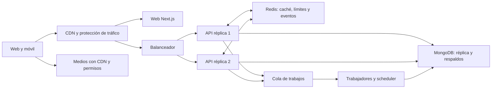

# Preparación real para producción y crecimiento

Revisión de código y configuración del 16 de octubre de 2026. Este documento define trabajo pendiente y criterios propuestos; no acredita capacidad medida ni equivale a un despliegue.

## Bloqueos observados y criterios de cierre

| Prioridad | Evidencia actual | Qué debe quedar comprobado |
| --- | --- | --- |
| P0: despliegue reproducible | El Dockerfile raíz copia `/app/frontend/dist` y nginx sirve ese directorio. La web actual usa Next.js con rutas dinámicas y genera `.next`. | Imagen web que ejecute el artefacto correcto de Next, API separada o enrutamiento explícito, TLS, variables por entorno y prueba desde una máquina limpia. |
| P0: configuración de datos | Compose activa credenciales root de Mongo y contraseña Redis, pero las URI de la app y del backup no incluyen autenticación. Además publica puertos de ambas bases en el host. | URI coherentes, usuarios de aplicación con permisos necesarios, bases en red privada, secretos fuera de imágenes y restauración probada. |
| P0: flujos completos | La última regresión general se detuvo sin completar. Las comprobaciones anteriores corresponden a instantáneas y alcances concretos. | CI completo sobre la misma versión a publicar, cobertura reportada, registro/login/2FA/reset, crear/editar evento, reservar/cancelar/check-in, grupos, moderación y notificaciones. Probar compras y reembolsos en entorno de prueba del proveedor. |
| P0: integraciones | La vista local desactiva Stripe/SMTP/Redis; Firebase no tiene credenciales locales. | Configuración por entorno y comprobación de entrega de correo, webhooks firmados y repetidos, almacenamiento, push y fallos de proveedores. |
| P0: contratos de producto | Pasaporte incluye ofertas hardcodeadas; Serrucho puede iniciar al creador como pagado sin verificación bancaria. | Ofertas respaldadas por acuerdos y canje real; estados distintos para compromiso, pago reportado y pago confirmado. Importes/monedas explícitos. |
| P0: acceso y abuso | Coros/mesa de asistentes y enlaces compartidos tienen superficies públicas; varios flujos nuevos necesitan pruebas de permisos/concurrencia. | Privacidad por rol, visibilidad consentida, bloqueo/denuncia, límites contra spam, aforo respetado bajo concurrencia y eliminación/retención de datos comprobadas. |
| P1: salud operativa | `/health` devuelve estado de proceso. La configuración de monitorización existe, pero no demuestra alertas ni recuperación operativas. | Readiness dependiente de servicios necesarios, liveness separada, métricas, alertas probadas, trazas sin datos sensibles, respaldo/restauración y rollback ensayados. |

Se observan nuevas funciones de filtrado por edad en discovery y ocultamiento de ubicación en eventos. La revalidación focalizada aprobó dos casos: exclusión del evento restringido en destacados/tendencias sin sesión y ocultamiento de dirección/coordenadas exactas secretas en listado/detalle públicos. El informe anterior describía una instantánea previa. Esto no cubre todavía todos los roles, edades, cachés o rutas relacionadas. Registro: `logs/readiness-privacy-results.log`.

## Qué impide simplemente añadir más servidores

1. `socketService.js` mantiene `connectedUsers` en un Map local y no configura un adaptador distribuido. Usuarios conectados a instancias distintas necesitan propagación de mensajes/presencia y soporte de múltiples dispositivos.
2. El servidor principal instancia e inicia cron en producción. Varias réplicas ejecutarían las mismas tareas; separar el scheduler o usar liderazgo/bloqueos e idempotencia.
3. Los límites de peticiones Express usan almacenamiento local por defecto. Compartir límites cuando haya varias réplicas y diferenciar autenticación, lecturas y escrituras; comprobar grupos detrás de una misma IP.
4. Mongo conecta sin presupuesto explícito de conexiones por réplica. Ajustar pool, límites de consultas y tiempos de espera junto con el número de instancias.
5. La página de votación consulta cada quince segundos cuando sigue abierta. Diez mil pantallas abiertas equivalen aproximadamente a 667 lecturas por segundo solo para esa consulta. Cada lectura actual carga las papeletas para recomputar resultados. Evaluar actualizaciones por eventos y resultados agregados con un contrato consistente.
6. Listados, mapas, importadores y notificaciones requieren paginación acotada, índices observados con planes de consulta, límites de radio/payload y procesamiento desacoplado de peticiones interactivas.

## Arquitectura objetivo propuesta

Mantener inicialmente un backend modular; el crecimiento no exige dividirlo en muchos microservicios.

- Usar al menos dos réplicas API como punto de partida de disponibilidad, dimensionadas después de medir; este número no garantiza una carga concreta.
- Configurar el adaptador compatible de Socket.IO y afinidad de sesión mientras se conserve HTTP long-polling. WebSocket y long-polling tienen requisitos diferentes.
- MongoDB con replicación y respaldo/restauración; índices por consultas reales y pool total limitado. La réplica mejora disponibilidad; no sustituye la optimización de escrituras.
- Redis para datos efímeros y coordinación, con política clara al fallar; votos, mensajes y pagos permanecen en almacenamiento duradero.
- Colas para importación, correo, push y transformaciones de medios; reintentos acotados, idempotencia y revisión de fallos persistentes.
- Medios servidos desde el proveedor/CDN. Un álbum privado requiere autorización por recurso, no solo conocer su URL.
- Despliegues graduales con rollback y métricas de errores, p95/p99, conexiones, cola y base de datos.

Fuentes técnicas primarias: [Socket.IO en varios nodos](https://socket.io/docs/v4/using-multiple-nodes/), [pool de conexiones MongoDB](https://www.mongodb.com/docs/drivers/node/current/connect/connection-options/connection-pools/).

## Cómo medir capacidad

Usuarios registrados, usuarios activos al día y usuarios concurrentes son cantidades distintas. Definir un mix de navegación, búsquedas/mapa, votos, chat, reservas y subidas, además de tamaños de respuesta y distribución de ciudades/eventos.

Ejemplo puramente aritmético: 10.000 personas simultáneas realizando una acción cada veinte segundos generan unas 500 acciones por segundo. Si cada acción dispara tres peticiones API, serían unas 1.500 peticiones por segundo, antes de añadir polling, sockets y medios. No son cifras de capacidad de esta app.

Probar en staging con datos sintéticos representativos y generadores separados: rampa, pico, carga sostenida y caída de una réplica/proveedor. Incluir un evento popular y varias escrituras sobre el mismo cupo. Proponer objetivos iniciales, a confirmar: menos de 1% de errores inesperados y p95 inferior a 500 ms en lecturas comunes; reportar operaciones lentas y timeouts aparte. Cero sobreventa, doble check-in o contabilización duplicada son invariantes, no promedios de rendimiento.

Elegir pruebas de tasa de llegada además de concurrencia para que la ralentización del sistema no reduzca artificialmente la carga ofrecida. Fuente: [modelos abiertos y cerrados de k6](https://grafana.com/docs/k6/latest/using-k6/scenarios/concepts/open-vs-closed/).

## Nuevas hipótesis psicológicas sin repetir módulos

La teoría de autodeterminación estudia autonomía, competencia y vinculación. Se utiliza como marco; las mejoras de conversión de estas propuestas deben comprobarse en EventNow. [Ryan y Deci, 2000](https://selfdeterminationtheory.org/SDT/documents/2000_RyanDeci_SDT.pdf).

| Propuesta | Aplicación concreta | Dónde integrarla | Qué comprobar |
| --- | --- | --- | --- |
| Sesión de prueba breve | Organizadores ofrecen explícitamente una modalidad de veinte minutos para conocer una actividad, con precio y condiciones claros. | Opciones del evento/entradas. | Primera asistencia, satisfacción y participación posterior; no prometer prueba gratuita o reembolso sin condiciones reales. |
| Presupuesto privado del grupo | Cada persona indica su máximo voluntariamente; el grupo ve opciones compatibles sin revelar límites individuales. | Votaciones existentes. | Planes confirmados y comodidad declarada, con moneda/cargos claros y minimización de datos. |
| Un papel pequeño y voluntario | Elegir llevar una pregunta, proponer una canción o enseñar un movimiento, con opción de participar solo observando. | Coros/anfitrión. | Facilidad para incorporarse y satisfacción; no vincular acceso o prestigio a cumplir tareas. |
| Primera vez en esta actividad | Eventos con nivel inicial declarado, materiales incluidos y expectativas concretas para principiantes. | Categorías/filtros y detalle del evento. | Primera asistencia y adecuación del nivel reportado, no etiquetas automáticas de experiencia. |
| Tradición del grupo | Tras un encuentro, proponer de forma voluntaria mantener un pequeño encuentro recurrente con frecuencia elegida. | Coro/tribu existente. | Segunda asistencia compartida y satisfacción; avisos editables y salida sencilla del grupo. |

Orden: corregir bloqueos de publicación y estabilizar lo existente; después probar presupuesto privado y modalidad para principiantes. Evaluar éxito por asistencia y satisfacción, considerando cancelaciones, bloqueos y frecuencia de avisos. No dar por efectivas las propuestas por invocar un mecanismo psicológico.
